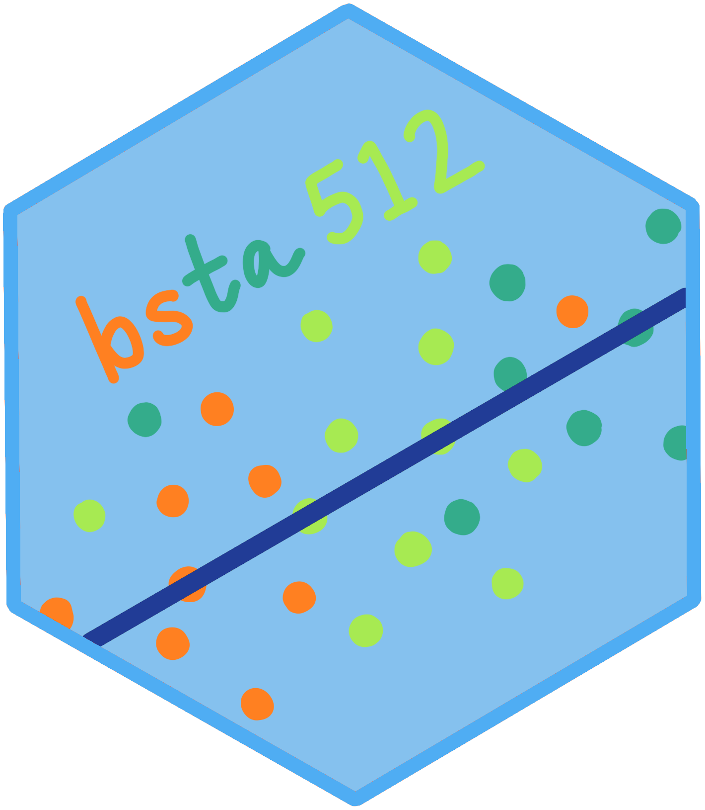

:::::: columns
::: {.column width="30%"}

:::

::: {.column width="5%"}
:::

::: {.column width="65%"}

::: columns
::: {.column width="24%"}
::: link-green2
[Winter 2026](https://nwakim.github.io/BSTA_512_26W/)
:::
:::
::: {.column width="1%"}
:::
::: {.column width="24%"}
::: link-green2
[Winter 2025](https://nwakim.github.io/BSTA_512_W25/)
:::
:::
::: {.column width="1%"}
:::
::: {.column width="24%"}
::: link-green2
[Winter 2024](https://nwakim.github.io/W2024_BSTA_512/)
:::
:::
:::

In this course, we will focus on linear models, and build our understanding of regression analysis. We will build some theoretical understanding in order to interpret and apply regression models appropriately. We will learn how to build a regression model, interpret the model, and diagnose potential issues with our model.
:::
::::::
